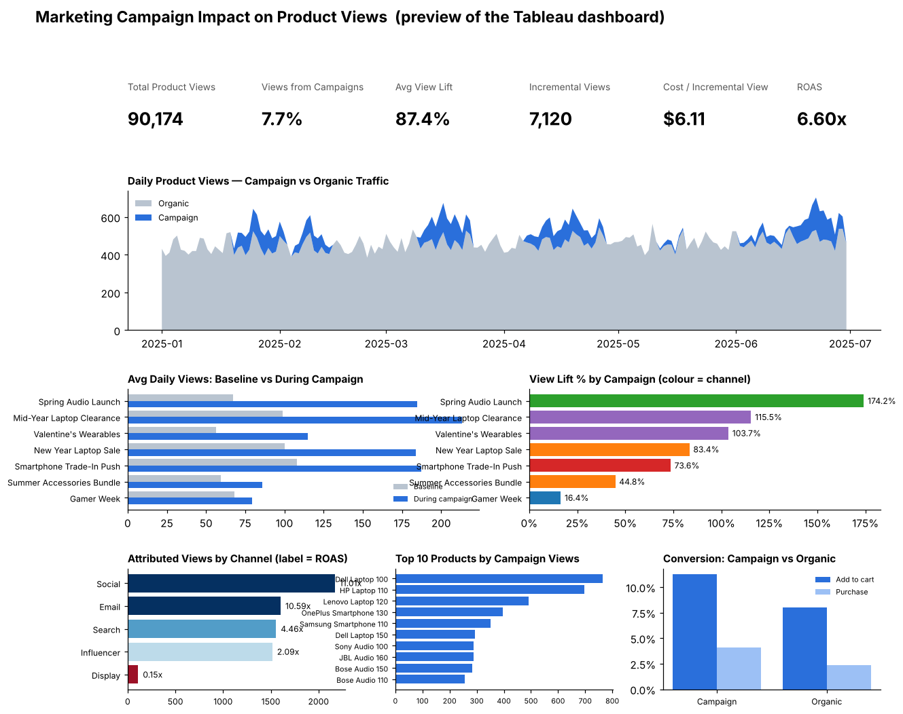

# Marketing Campaign Impact on Product Views — Task 8

## Project Overview

This project tracks how marketing campaigns change **product views** on the Mankind Matrix store. It answers four questions:

1. **Did views go up?** How do daily views of the targeted category compare with the 14 days before the campaign? (view lift %)
2. **How many extra views did we get?** Incremental views = (campaign daily avg − baseline daily avg) × campaign days.
3. **Which channels and products responded?** Attributed views by channel, top products per campaign.
4. **Did the views turn into business?** View → add-to-cart → purchase, attributed revenue, cost per incremental view, ROAS.

The dashboard is built in **Tableau** on synthetic CSV data that follows `mankind_matrix_db` conventions.

---

## Project Structure

```
campaign_impact_dashboard/
├── data/
│   ├── campaigns.csv                 # 7 campaigns: channel, dates, target category, budget
│   ├── product_views.csv             # ~90K view events (Jan–Jun 2025) with source + campaign attribution
│   ├── products.csv                  # 48 products across 6 categories
│   ├── campaign_impact_summary.csv   # one row per campaign: baseline vs campaign, lift, ROAS
│   └── views_for_tableau.csv         # views + product + campaign in one flat table (Tableau source)
├── scripts/
│   ├── generate_campaign_data.py     # regenerates all CSVs (seeded, reproducible)
│   └── build_tableau_workbook.py     # regenerates the Tableau workbook from the CSVs
├── tableau/
│   ├── campaign_impact_dashboard.twbx   # packaged workbook with data — OPEN THIS ONE
│   └── campaign_impact_dashboard.twb    # unpackaged source, reads ../data
└── docs/
    ├── README.md                     # this file
    ├── data_dictionary.md            # field definitions + metric formulas
    ├── dashboard_guide.md            # dashboard contents, expected values, how to read it
    └── screenshots/dashboard_preview.png   # reference render of the expected dashboard
```

## Open the Dashboard

Open `tableau/campaign_impact_dashboard.twbx` in Tableau Desktop (2026.1 or later). It opens on the **Campaign Impact** dashboard. The data is packaged inside, so no setup is needed.



---

## Data Sources

| Source | Type | Description |
|--------|------|-------------|
| `mankind_matrix_db` | MySQL (upstream) | Production database. Product/user ids follow its conventions; the workbook does not connect to it directly. |
| `product_views.csv` | CSV (synthetic) | Event-level fact table, one row per product view |
| `campaigns.csv` | CSV (synthetic) | Campaign dimension |
| `products.csv` | CSV (synthetic) | Product dimension |
| `campaign_impact_summary.csv` | CSV (derived) | Pre-calculated lift metrics per campaign (produced by the script from the other three files) |

> **Note:** In production, the views table would come from web analytics/clickstream events (e.g. a `product_view` event with UTM parameters). `campaign_id` is assigned when the view's UTM campaign matches a campaign in `campaigns.csv`.

---

## Methodology

- **Baseline:** average daily views of the campaign's `target_category` in the **14 days before** `start_date`.
- **Campaign period:** average daily views of the same category from `start_date` to `end_date` (inclusive).
- **Lift %** = (campaign avg / baseline avg − 1) × 100.
- **Attributed views:** views whose `campaign_id` is set (arrived via the campaign's UTM link). Attributed views can be lower or higher than incremental views — attributed counts *who clicked*, incremental counts *what changed*.
- Campaigns on the same category don't overlap, so each baseline is clean.

**Limitations:** pre/post comparison doesn't control for seasonality or other events. For a stronger read, compare with a non-targeted category over the same dates (the trend sheet makes this easy to eyeball) or run a holdout test.

---

## Key Results (synthetic data)

| Campaign | Channel | Category | Lift % | Incremental views | ROAS |
|---|---|---|---|---|---|
| Spring Audio Launch | Influencer | Audio | **174.2%** | 1,643 | 2.09 |
| Mid-Year Laptop Clearance | Social | Laptops | 115.5% | 1,602 | 16.92 |
| Valentine's Wearables | Social | Wearables | 103.7% | 586 | 1.81 |
| New Year Laptop Sale | Email | Laptops | 83.4% | 1,170 | 14.79 |
| Smartphone Trade-In Push | Search | Smartphones | 73.6% | 1,667 | 4.46 |
| Summer Accessories Bundle | Email | Accessories | 44.8% | 373 | 0.51 |
| Gamer Week | Display | Gaming | **16.4%** | 79 | 0.15 |

- **Biggest lift:** Spring Audio Launch (influencer) almost tripled Audio views.
- **Best return:** the two Laptop campaigns — high-priced products make each purchase worth more.
- **Weakest:** Gamer Week (display ads) barely moved views and returned $0.15 per $1 spent — a candidate to cut or rework.

---

## How to Regenerate the Data

```bash
cd campaign_impact_dashboard/scripts
python generate_campaign_data.py
```

Requires `pandas` and `numpy`. The seed is fixed (`SEED = 42`), so results are reproducible.

To rebuild the workbook after changing the data:

```bash
python build_tableau_workbook.py
```
